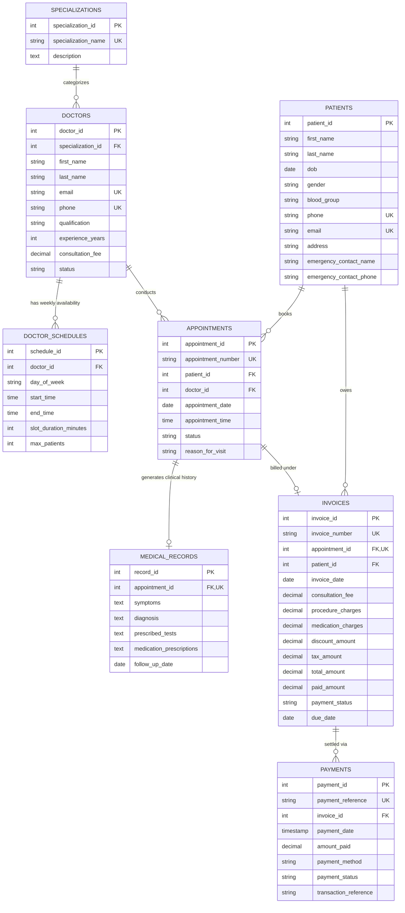

# 🏥 Hospital & Clinic Appointment and Billing Management System

A production-grade, enterprise-ready Relational Database Management System (RDBMS) project designed for managing healthcare clinics, private practices, and multi-specialty hospitals.

---

## 🎯 Project Focus & Core Modules

1. **Patients Management**: Demographic details, medical background, emergency contacts, and patient registration history.
2. **Doctors & Specializations**: Multi-specialty classification (Cardiology, Dermatology, Orthopedics, Pediatrics, etc.), doctor qualifications, consultation fees, and weekly roster availability.
3. **Appointment Scheduling**: Smart appointment booking with slot duration, reason for consultation, appointment status workflow (`Scheduled` ➔ `Confirmed` ➔ `Completed` / `Cancelled` / `No-Show`), and double-booking conflict prevention.
4. **Clinical Notes / Medical Records**: Diagnosis, symptoms, prescribed clinical tests, and prescription details linked to completed consultations.
5. **Billing & Invoices**: Itemized bills (consultation fee, procedures, medications, discounts, and taxes), payment terms, due dates, and real-time payment status (`Unpaid`, `Partially Paid`, `Paid`, `Refunded`).
6. **Payments Tracking**: Multi-channel transaction tracking (UPI, Credit/Debit Card, Net Banking, Cash, Health Insurance TPA) with automatic reconciliation.

---

## 📊 Entity Relationship Diagram (ERD)



---

## 📁 Repository Structure

```plaintext
Hospital & Clinic Appointment System/
├── README.md                      # Project documentation and architectural guide
├── run_demo.py                    # Standalone interactive Python/SQLite test runner
├── hospital_demo.db               # Pre-populated portable SQLite database file
├── mysql/                         # MySQL / MariaDB compatible SQL scripts
│   ├── 01_schema.sql              # DDL: Tables, constraints, unique indexes, foreign keys
│   ├── 02_seed_data.sql           # Realistic demo dataset (doctors, patients, invoices, payments)
│   ├── 03_views.sql               # Reporting views (doctor roster, billing detail, department KPI)
│   ├── 04_stored_procedures.sql   # Booking logic, invoice creation, payment recording
│   ├── 05_triggers.sql            # Doctor status check, auto-completion, payment reconciliation
│   └── 06_analytical_queries.sql  # 8 complex business KPI queries (CTEs, Window Functions)
└── postgresql/                    # PostgreSQL 14+ / 18+ compatible SQL scripts
    ├── 01_schema.sql              # PostgreSQL DDL with SERIAL keys and check constraints
    ├── 02_seed_data.sql           # Complete dataset with sequence synchronization
    ├── 03_views.sql               # PostgreSQL views with STRING_AGG, TO_CHAR, AGE
    ├── 04_functions_triggers.sql  # PL/pgSQL functions, triggers, and stored procedures
    └── 05_analytical_queries.sql  # Advanced SQL queries optimized for PostgreSQL
```

---

## ⚡ Quick Start: Instant Test (Zero Setup Required)

You can run the entire system immediately using Python's built-in SQLite engine without needing to configure a database server:

```powershell
python run_demo.py
```

This will automatically:
1. Create all 8 database tables with foreign keys and constraints.
2. Seed realistic doctors, patients, appointments, invoices, and payments.
3. Execute the analytical queries and display cleanly formatted ASCII tables in your terminal.
4. Export and persist the database to `hospital_demo.db`.

---

## 🗄️ Database Setup Instructions

### Option A: PostgreSQL Setup (PostgreSQL 14 / 16 / 18)

Open PowerShell and execute using `psql`:

```powershell
# 1. Connect to PostgreSQL and create the database
psql -U postgres -c "CREATE DATABASE hospital_clinic_db;"

# 2. Run the scripts in sequence
psql -U postgres -d hospital_clinic_db -f "postgresql/01_schema.sql"
psql -U postgres -d hospital_clinic_db -f "postgresql/02_seed_data.sql"
psql -U postgres -d hospital_clinic_db -f "postgresql/03_views.sql"
psql -U postgres -d hospital_clinic_db -f "postgresql/04_functions_triggers.sql"
psql -U postgres -d hospital_clinic_db -f "postgresql/05_analytical_queries.sql"
```

### Option B: MySQL Setup (MySQL Workbench or MySQL CLI)

```powershell
# Run the scripts in sequence via MySQL CLI:
mysql -u root -p < mysql/01_schema.sql
mysql -u root -p hospital_clinic_db < mysql/02_seed_data.sql
mysql -u root -p hospital_clinic_db < mysql/03_views.sql
mysql -u root -p hospital_clinic_db < mysql/04_stored_procedures.sql
mysql -u root -p hospital_clinic_db < mysql/05_triggers.sql
mysql -u root -p hospital_clinic_db < mysql/06_analytical_queries.sql
```

---

## ⚙️ Key Stored Procedures & Triggers

### 1. `sp_book_appointment`
Safely books an appointment by verifying:
- Doctor exists and is currently in `Active` status.
- Doctor does not already have a conflicting booking at the same date and time slot.
- Automatically generates an appointment code (e.g., `APT-20261020-4921`).

### 2. `sp_generate_invoice`
Generates an itemized patient bill upon consultation:
- Automatically pulls doctor's baseline consultation fee.
- Adds optional diagnostic procedure and medication charges.
- Computes discounts and tax rates.
- Sets due date and initial `Unpaid` status.

### 3. `sp_record_payment`
Processes payments made towards an invoice:
- Prevents payment exceeding the outstanding balance.
- Inserts a transaction into `payments`.
- Automatically reconciles the invoice's `paid_amount` and transitions status from `Unpaid` ➔ `Partially Paid` ➔ `Paid`.

### 4. Database Integrity Triggers
- **`trg_validate_doctor_availability`**: Blocks appointment scheduling if a doctor is marked `On Leave` or `Inactive`.
- **`trg_mark_appointment_completed`**: When clinical notes are logged in `medical_records`, the corresponding appointment is automatically updated to `Completed`.
- **`trg_reconcile_invoice_payment`**: Re-evaluates payment totals upon payment insertions to prevent manual billing discrepancies.

---

## 📈 Advanced Analytical SQL Queries Included

1. **Doctor Revenue Leaderboard**: Uses `DENSE_RANK() OVER (...)` to rank doctors by gross and collected revenue.
2. **Cumulative Revenue Velocity**: Uses `SUM() OVER (ORDER BY date)` to track running totals of daily collections.
3. **Patient Retention Cohort Analysis**: Uses CTEs to classify patients into *One-Time* vs *Repeat / Loyal* patients.
4. **Specialization Performance & No-Show Rate**: Department-level completion, cancellation, and no-show metrics.
5. **Outstanding Balance Aging Analysis**: Segregates pending payments into delinquency buckets (`Current`, `1-7 Days Overdue`, `8-15 Days`, `15+ Days Delinquent`).
6. **Peak Appointment Hours Heatmap**: Identifies peak clinic hours using hourly aggregation.
7. **Payment Method Market Share**: Analyzes percentage breakdown of UPI, Cash, Cards, and Insurance settlements.
8. **Patient Spend by Demographic Age Groups**: Aggregates healthcare spending across Pediatric, Young Adult, Middle-Aged, and Senior Citizen groups.

---

## 🛡️ License & Academic Integrity
Created for educational, demonstration, and production architecture reference. Free to adapt and customize for your own hospital management applications.
